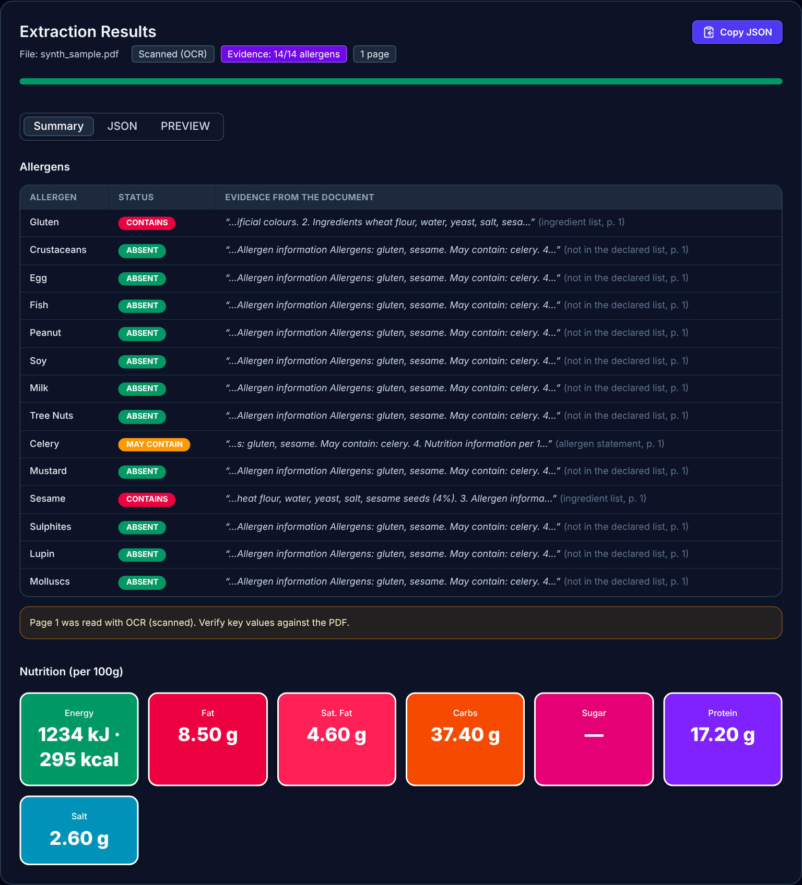

<h1 align="center">NutriParse</h1>

<p align="center">
  Evidence-first extraction of the 14 EU allergens and nutrition facts from food specification sheets (PDF, digital or scanned).
</p>

<p align="center">
  <a href="https://github.com/amiltonkoxi/nutriparse-reader/actions/workflows/ci.yml"></a>
  
  
</p>

---

Quality teams at retailers and distributors receive hundreds of supplier
specification sheets and check allergens by hand. NutriParse reads the PDF,
returns the status of each of the 14 allergens of Regulation (EU)
No 1169/2011 (Annex II), and **cites the text in the document behind every
result**. When the document says nothing, it says `unknown` instead of
guessing, so a person knows exactly what to check.

<p align="center"></p>

## Results

Held-out synthetic test set (120 sheets in Hungarian, English and Polish,
10 declaration formats, 212 PDFs including simulated scans). The baseline is
the previous version of this project, run on the same extracted text.

| | accuracy | **unsafe miss rate** | abstention |
|---|---|---|---|
| NutriParse v1 | **92.5%** | **0.0%** | 7.6% |
| v0.3 baseline | 53.9% | 51.0% | 28.4% |

*Unsafe miss rate*: share of allergens present in the product (contains or
may contain) that were reported as absent. That is the error that can hurt
a consumer, and the CI fails if it is not zero.

| input | accuracy | unsafe miss | abstention |
|---|---|---|---|
| digital PDF | 99.7% | 0.0% | 0.3% |
| good scan | 90.2% | 0.0% | 9.4% |
| poor scan | 76.2% | 0.0% | 24.8% |

As scans get worse the system abstains more, but it does not start guessing
"absent". Method, protocol, ablation and limitations:
[docs/method.md](docs/method.md). Full reports:
[evaluation/results](evaluation/results).

## How it works

```
PDF ─► pages ─► words + boxes ─► evidence rules ─► fusion ─► status + evidence + page
        │            ▲
        │  scanned page? ── Tesseract OCR (hun + pol + eng)
        └─► page image ─► visual cell readers (tick boxes, table flags)
```

* **One document model for text and OCR.** Both produce words with bounding
  boxes; only pages without a text layer are OCR'd.
* **Evidence rules** for the formats seen on real sheets: ingredient lists,
  "contains / may contain" statements, "no allergens" statements, I/N and
  two-column tables, tick boxes, numbered +/- grids, and X marks placed under
  column headings (read by geometry, not text).
* **Visual cell readers** for what OCR drops in scanned tables: the ink inside
  each tick box, and a single-line re-read of each row's flag cells.
* **Safety-first fusion**: `unknown` by default, most severe status wins
  among direct evidence, and contradictions are kept as `conflict` for review.
* **Multilingual lexicon** (HU / EN / PL) that handles Hungarian case endings
  and common traps such as cocoa butter, coconut milk and "kén-dioxid".

## Quick start

Requirements: Python 3.11+, Node 20+, Tesseract with `hun` and `pol` models,
Poppler.

```bash
# Debian/Ubuntu: sudo apt install tesseract-ocr tesseract-ocr-hun tesseract-ocr-pol poppler-utils
# macOS:         brew install tesseract tesseract-lang poppler
make install
make dev          # API on :8000, web app on :3000
```

Or only the API, with Docker:

```bash
docker build -t nutriparse-api backend
docker run -p 8000:8000 -e ALLOWED_ORIGINS=http://localhost:3000 nutriparse-api
```

## API

`POST /extract` with a multipart `file` (PDF, up to 15 MB and 30 pages).
Interactive docs at `/docs`.

```json
{
  "meta": {
    "extraction_mode": "ocr", "pages": 1, "ocr_pages": [1],
    "allergen_coverage": 1.0, "needs_review": false, "languages": ["en"]
  },
  "allergens": {
    "gluten": {
      "status": "contains",
      "evidence": "…2. Ingredients wheat flour, water, yeast, salt…",
      "basis": "ingredients", "page": 1, "conflict": false
    },
    "celery": {
      "status": "traces",
      "evidence": "…Allergens: gluten, sesame. May contain: celery…",
      "basis": "statement", "page": 1, "conflict": false
    }
  },
  "nutrition_per_100g": { "energy_kJ": 1234, "energy_kcal": 295, "fat_g": 8.5, "salt_g": 2.6 },
  "diagnostics": { "warnings": ["Page 1 was read with OCR (scanned). Verify key values against the PDF."] }
}
```

Errors: `413` file too large, `415` not a PDF, `422` unreadable or too many
pages.

## Reproduce the evaluation

```bash
make test                       # 47 unit and API tests
make bench                      # synthetic test split (seed 2, 120 sheets, with scans)
make bench-real REAL=/path/pdfs # private real-world set, matched by SHA-256
```

## Project layout

```
backend/nutriparse/   extraction, allergen rules, visual readers, fusion, API
backend/tests/        unit tests per declaration format, API tests
evaluation/           benchmark generator, evaluation script, v0.3 baseline, results
docs/method.md        method, protocol, metrics, results, limitations
frontend/             Next.js web app
```

## Limitations

The synthetic benchmark and the engine were written by the same author, and
the real-world set is small (10 food sheets) and was used for development.
The numbers above are a strong signal, not a guarantee for unseen layouts.
Only Hungarian, English and Polish are supported. See
[docs/method.md](docs/method.md#6-limitations).

## Deployment

* API: Docker on Render (`render.yaml`), `ALLOWED_ORIGINS` lists the web app's
  origin. Credentials are not accepted cross-origin.
* Web app: Vercel, with `NEXT_PUBLIC_API_BASE` pointing at the API.

## License

[MIT](LICENSE)
